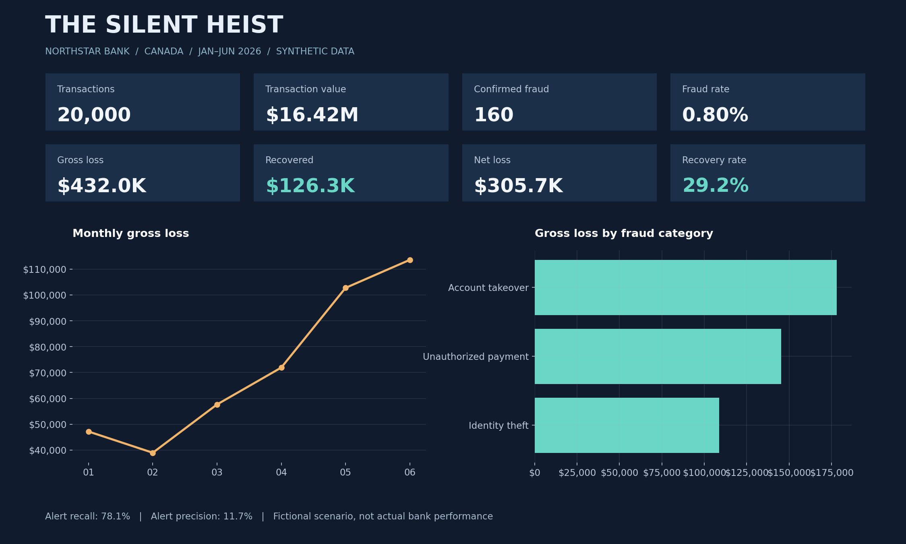

# THE SILENT HEIST — Follow the Money

**Canadian banking financial crime analytics | Fictional Northstar Bank | Jan–Jun 2026**

A simulated bank faces increasing fraud losses. Should it invest CAD $150,000 in prevention technology?

## Results (synthetic)

| KPI | Result |
|---|---:|
| Transactions | 20,000 |
| Transaction value | $16.42M |
| Confirmed fraud | 160 |
| Fraud rate | 0.80% |
| Gross loss | $432.0K |
| Recovered | $126.3K |
| Net loss | $305.7K |
| Recovery rate | 29.2% |

## I — Follow the Money
20,000 transactions, 5,000 fictional customers, five provinces. SQL and Python identify loss trends and compare channels, regions and categories. Confirmed fraud is a simulated outcome, not equivalent to an alert. Alert recall is 78.1%; precision is 11.7%. Fraud incidence rises by design, so the trend is not independent empirical evidence.

## II — Count the Damage
Gross losses are CAD $431,994.65; recoveries are CAD $126,309.51; net losses are CAD $305,685.14. Account takeover is the largest simulated gross loss category.

## III — Stop the Next Heist
Base case: annualize six-month net losses, assume 35% prevention effectiveness, $30,000 annual operating cost, 3% annual loss growth and 10% discount rate. Initial investment $150,000. Three-year NPV: $322,626; ROI: 280.9%. These are conditional projections, not realized benefits.

## Recommendations
- Prioritize a controlled pilot for the highest-loss category; compare loss reduction with a control group.
- Review alert quality and investigator workload before deploying changes; monitor recall and precision together.
- Proceed to a controlled pilot and validate savings before full rollout.

## Repository
- [Transactions](data/transactions.csv) and [customers](data/customers.csv)
- [Python notebook](python/analysis.ipynb) and [generator](python/generate.py)
- [10 SQLite queries](sql/fraud_analysis.sql) and [executed results](sql/query_results.md)
- [Excel financial model and dashboard](financial_model.xlsx)
- [Power BI setup](power-bi/BUILD.md), [DAX](power-bi/measures.dax), [theme](power-bi/theme.json) — native PBIX not yet built
- [Data dictionary](data/DATA_DICTIONARY.md)

## Reproduce
Install dependencies with `pip install -r requirements.txt`, then open `python/analysis.ipynb` in Jupyter and run all cells. The fixed seed reproduces the CSVs. SQL uses SQLite. Excel model inputs are editable.

## Data provenance and limitations
All transaction and customer records are synthetic. The 0.8% fraud rate, growth pattern, recoveries, alerts and costs are modelling assumptions, not Canadian bank statistics. For independent Canadian context see the [Canadian Anti-Fraud Centre](https://antifraudcentre-centreantifraude.ca/); its reported incidents are not used as a transaction-level calibration source. No real customer data is included. No actual fraud detection model is trained.
